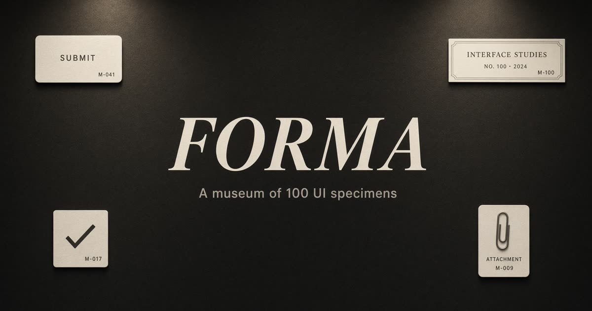
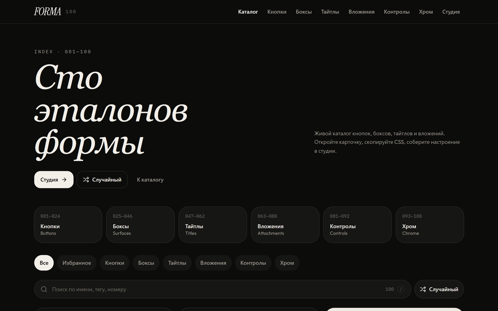
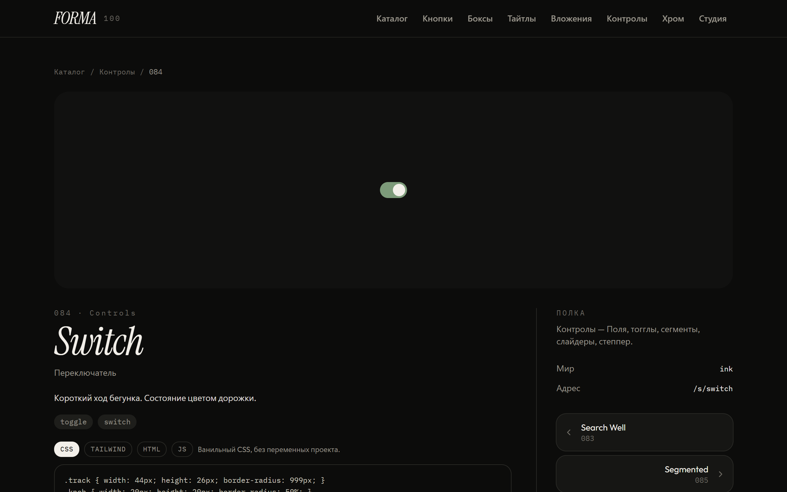
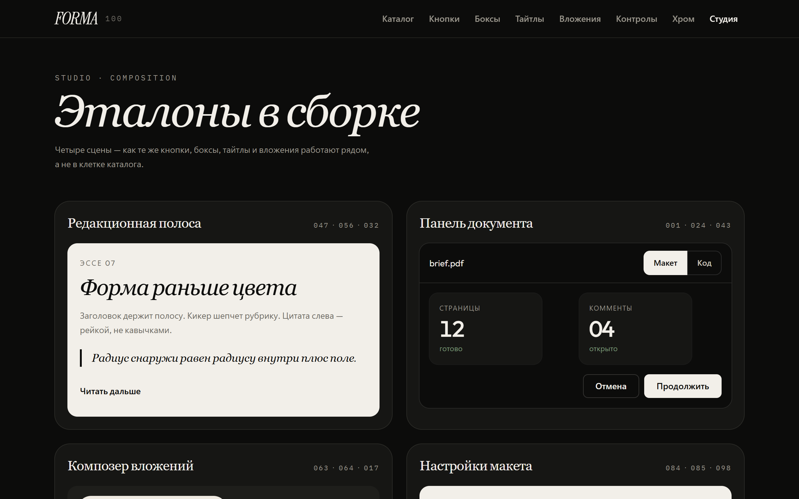

<p align="center">
  
</p>

<h1 align="center">FORMA</h1>

<p align="center">
  <strong>A museum of 100 live UI specimens.</strong><br />
  Buttons, boxes, titles, attachments — not screenshots: real controls you can press, copy and take.<br />
  <em>Сто эталонов формы.</em>
</p>

<p align="center">
  <a href="https://github.com/god4claw/FORMA/actions/workflows/ci.yml"></a>
  <a href="LICENSE"></a>
  
  
  
  
</p>

<p align="center">
  <a href="#catalog">Catalog</a> ·
  <a href="#one-page-per-specimen">Specimen pages</a> ·
  <a href="#studio">Studio</a> ·
  <a href="#getting-started">Getting started</a> ·
  <a href="#structure">Structure</a> ·
  <a href="#русский">Русский</a>
</p>

---

FORMA is a field catalogue of interface form. Every specimen is a working control
in its own visual world: press it, copy its CSS recipe, keep it in favourites, or
open its own page and share the link.

<p align="center">
  
</p>

No accounts, no database, no tracking. Favourites live in `localStorage`.

## Catalog

One hundred units, six shelves.

| # | Shelf | Range | What you get |
| --- | --- | --- | --- |
| 01 | **Buttons** / Кнопки | 001–024 | Fill, ghost, stamp, pill, FAB, split, press |
| 02 | **Surfaces** / Боксы | 025–046 | Sheet, ticket, polaroid, window, notebook, envelope |
| 03 | **Titles** / Тайтлы | 047–062 | Italic display, drop cap, kicker, pull quote, small caps |
| 04 | **Attachments** / Вложения | 063–080 | File chip, PDF, unfurl, avatars, progress, mention |
| 05 | **Controls** / Контролы | 081–092 | Field, switch, segments, OTP, stepper, range |
| 06 | **Chrome** / Хром | 093–100 | Banner, toast, tabs, crumbs, empty, pagination |

### Worlds

Specimens are not all on the same background. Six fields keep the contrast honest:

| World | Field | Use |
| --- | --- | --- |
| `ink` | Warm black | Product chrome on dark |
| `paper` | Ivory | Editorial, print, forms |
| `mist` | Clay | Soft product, quiet depth |
| `studio` | Kraft | Analog, paper objects |
| `night` | Near-void | Terminal, toast, FAB |
| `grid` | Modular 16px | Technical, spec, index |

## One page per specimen

Every unit has a permanent address — `/s/ink-fill`, `/s/brutal-stamp`, `/s/quote-rail` —
with its own `<title>`, description, canonical link and Open Graph tags. So a
specimen can be bookmarked, sent to a colleague, or found by a search engine.

On the page you get the live control at full size, the note, the tags, the CSS
recipe with one-click copy, favourites, and previous/next inside the shelf.

<p align="center">
  
</p>

## Studio

Four scenes where the same units stand next to each other instead of in a grid
cell: editorial strip, document panel, attachment composer, layout settings. The
numbers in each scene header link to the specimens they are built from.

<p align="center">
  
</p>

## Features

- **Live specimens** — every unit is interactive, not a static mock
- **Copy CSS, Tailwind or HTML** — the recipe sits under the note, derived into utilities on demand, and cut into a self-contained HTML fragment with its styles; one click, announced to screen readers
- **Permanent links** — `/s/<slug>` per specimen, with metadata for sharing
- **Favorites** — bookmarks persist in the browser
- **Search** — name, tag, Russian label, or number (`/` focuses the field)
- **Random** — jump to one specimen when you need a starting point
- **Prev / next** — arrow keys walk the current shelf from the quick view

## Stack

- [React 19](https://react.dev) + [TanStack Start](https://tanstack.com/start) / Router
- [Tailwind CSS v4](https://tailwindcss.com) — tokens in `src/styles.css`
- [Radix UI](https://www.radix-ui.com) dialog primitive
- [Zustand](https://github.com/pmndrs/zustand) for favourites
- [Lucide](https://lucide.dev) icons
- Typefaces: [Instrument Serif](https://fonts.google.com/specimen/Instrument+Serif), [Outfit](https://fonts.google.com/specimen/Outfit), [IBM Plex Mono](https://fonts.google.com/specimen/IBM+Plex+Mono)

Nine runtime dependencies, no server state.

## Getting started

```bash
git clone https://github.com/god4claw/FORMA.git
cd FORMA
npm install
npm run dev
```

Then open the app and:

1. Filter a shelf, or hit **Случайный**
2. Open a specimen, copy the CSS, or open its page and copy the address
3. Walk through **Студия** to see the same units in a layout

| Script | What it does |
| --- | --- |
| `npm run dev` | Vite dev server |
| `npm run build` | Production build (Nitro, Vercel preset) |
| `npm run preview` | Serve the production build |
| `npm run typecheck` | `tsc --noEmit` |
| `npm run lint` | ESLint |
| `npm test` | Catalogue unit tests (`node --test`) |
| `npm run format` | Prettier |

Typecheck, lint, tests and build run in CI on every push and pull request.

## Deploy

`npm run build` emits the plain TanStack Start output in `dist/` — a Node server
plus client assets — which is what `npm run preview` serves. On Vercel the
platform sets `VERCEL=1`, and the build switches to Nitro's Vercel output
instead; no extra configuration is needed.

Set `VITE_SITE_URL` to the public origin so canonical links and `og:image` are
absolute:

```bash
VITE_SITE_URL=https://your-domain.example npm run build
```

See [`.env.example`](.env.example).

## Structure

```text
src/
  routes/
    __root.tsx                Shell, fonts, site-wide meta
    index.tsx                 Catalog
    collection.$slug.tsx      Shelf (buttons, surfaces, type, chips, controls, chrome)
    s.$slug.tsx               One specimen, with its own metadata
    studio.tsx                Four composed scenes
  components/
    specimens/live.tsx        The 100 live units
    specimen-frame.tsx        Card in the grid
    specimen-detail.tsx       Quick view: note, tags, CSS, prev/next
    specimen-css.tsx          Recipe in three formats: CSS, Tailwind, HTML
    specimen-grid.tsx         Search, shuffle, grid
    layout.tsx                Shell, nav
  lib/
    specimens.ts              Catalogue data, search, neighbours, paths
    specimens.test.ts         Unit tests for the above
    tailwind.ts               CSS recipe → Tailwind utilities
    tailwind.test.ts          Tests for the derivation, all 100 specimens
    snippet.ts                Live DOM + matching rules → standalone HTML
    favorites.ts              Zustand + persist
    site.ts                   Site name, description, absolute URLs
  styles.css                  Theme tokens
  specimens.css               Per-unit styles
public/
  og.jpg                      Share card
  favicon.svg
.github/workflows/ci.yml      Typecheck, lint, test, build
```

## Add a specimen

Append to `SPECIMENS` in [`src/lib/specimens.ts`](src/lib/specimens.ts), draw it in
[`src/components/specimens/live.tsx`](src/components/specimens/live.tsx), give it a
class in [`src/specimens.css`](src/specimens.css). The tests check that ids, slugs
and shelf ranges stay consistent.

Details and house rules: [CONTRIBUTING.md](CONTRIBUTING.md).

## Accessibility

- every card links to its page, so nothing is mouse-only;
- the quick view is a Radix dialog: focus trap, Escape, labelled title;
- copy results are announced through a polite live region, failures included;
- search exposes `/` via `aria-keyshortcuts`;
- the global reset honours `prefers-reduced-motion`.

## Design notes

FORMA prefers **form before colour**. One accent (ivory on ink), two type
families, concentric radii, hairline borders. Status colour appears only on the
marker — never on the whole panel.

The CSS under each card is a recipe, not a design-token dump. Steal the gesture
(offset shadow, underscore, stamp) and restyle it in your own system.

### Why CSS first, Tailwind second

The specimens are authored in plain CSS on purpose: a catalogue of *form* should
not require a particular toolchain to read. The Tailwind tab is a derivation of
the same declarations — states become variants (`hover:`, `active:`,
`data-[on=true]:`), descendant rules become `[&_span]:`, multi-element recipes are
grouped by selector, and anything without a named utility falls back to an
arbitrary value (`[inset:8px_-6px_auto]`). That means the two tabs can never
disagree, and a new specimen needs no second version.

What the derivation does not hide: `animation` still needs the keyframes from
`specimens.css`, `content` only makes sense on `::before`/`::after`, and a font
family resolves to the closest generic (`font-serif`).

### The HTML fragment

The HTML tab is not hand-written either. It takes the rendered specimen, keeps
every rule from the loaded stylesheets that actually matches it, pulls in the
custom properties and `@keyframes` those rules reference, and prints markup with
that `<style>` block. Paste it into an empty file and it looks like the card.

It is a snapshot, not a component: state and handlers are not part of it. For
behaviour, read `src/components/specimens/live.tsx` — the units are plain React
components with local state.

## License

[MIT](LICENSE) © 2026 [god4claw](https://github.com/god4claw)

---

<a id="русский"></a>

## Русский

**FORMA** — полевой каталог из ста живых эталонов интерфейса.

Шесть полок: кнопки, боксы, тайтлы, вложения, контролы, хром. Каждый эталон
работает: его можно нажать, скопировать CSS, положить в избранное. У каждого
свой адрес — `/s/ink-fill` — с заголовком и карточкой для соцсетей, так что
эталон можно просто отправить ссылкой.

В **Студии** те же формы стоят уже не в клетке сетки, а в сборке: редакционная
полоса, панель документа, композер вложений, настройки макета.

```bash
npm install
npm run dev
```

Ни аккаунтов, ни базы, ни трекеров. MIT. Берите форму, оставляйте цвет себе.
